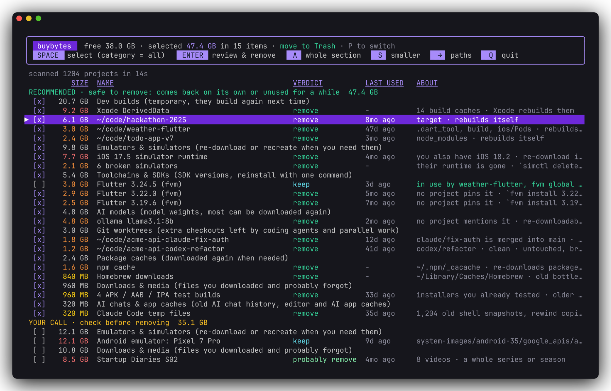
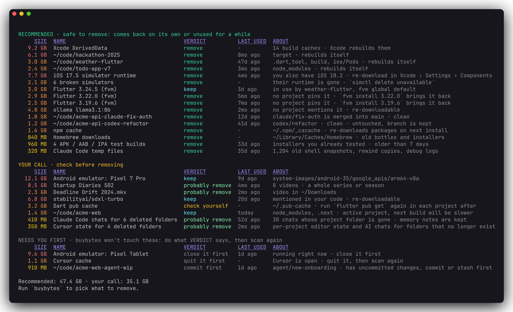
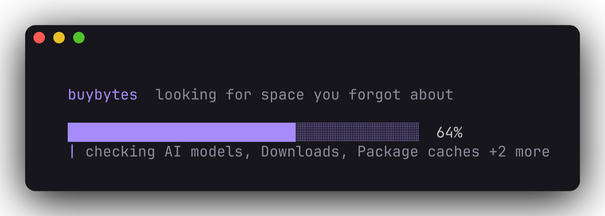
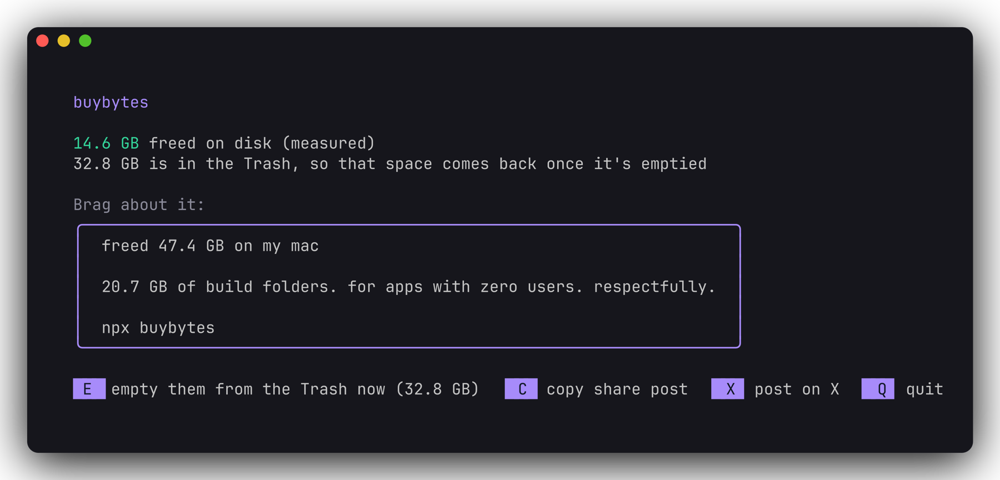

# buybytes

**Buy back your bytes!** Find the disk space you forgot about, then keep or remove each item.

General Mac cleaners clear system caches. buybytes looks at developer
leftovers that take far more space, and it checks whether you still use each
one before it suggests removing it:

| What | How it decides |
|---|---|
| **Git worktrees**: extra checkouts from coding agents and parallel work | Offered only if `git` says the worktree is clean. Recommended if its branch is merged or it's untouched for 30+ days |
| **Dev builds**: Flutter `build/`, `.dart_tool`, `node_modules`, Pods, Cargo `target/`, Gradle `build/`, Python venvs | Recommended once the project is untouched for 7+ days, because they rebuild themselves |
| **Toolchains**: fvm Flutter versions, Gradle versions, iOS DeviceSupport, NDKs | fvm versions that no project's `.fvmrc` pins (versions in use are listed unchecked, with who uses them), Gradle versions that no project's wrapper uses |
| **Emulators & simulators**: Android emulators, unused system images, simulator runtimes, broken simulators | Last-booted date. Emulators that are running are never offered |
| **AI models**: Hugging Face, Ollama, LM Studio, `ckpts/` folders inside repos | Whether any of your projects mention the model, and when its weights were last read |
| **AI chats & app caches**: Claude Code, Codex and Gemini CLI chat history, Claude Code temp files, Cursor/VS Code/Claude app caches, editor state for deleted folders | Chats for folders that no longer exist, or older than 30 days. Memory notes and recent chats are never offered. App caches only while the app is closed |
| **Downloads & media**: movies, whole seasons, old `.apk`/`.ipa`/`.dmg` files, big forgotten folders | Age, and whether the file is something you already installed |
| **Package caches**: npm, Yarn, Bun, uv, pip, Homebrew, CocoaPods, SwiftPM, Go, Docker | Regenerable ones are recommended |



## Install

```bash
npx buybytes            # try it without installing
npm i -g buybytes       # or install it
buybytes skill install  # teach Claude Code and Codex to use it
```

macOS only for now (Apple silicon and Intel).

## Use it

```bash
buybytes                  # scan, then pick in a checklist
buybytes scan             # just print what it found
buybytes scan --all       # include "your call" items under 300 MB
buybytes scan --json      # for scripts and coding agents
buybytes scan --show-ids  # ids for `clean --ids`
buybytes clean --ids 7bab91b4,e9958a77
buybytes clean --recommended --dry-run
```



Every item gets a VERDICT: **remove**, **probably remove**, **keep**,
**check yourself**, or for things buybytes won't touch, what you need to do
first (**commit first**, **close it first**). Sizes are coloured red (5 GB+),
orange (1 GB+) and yellow (300 MB+).

Everything in RECOMMENDED is listed. In YOUR CALL, items under 300 MB are
folded into one line so the list stays short.



In the checklist:

| Key | Action |
|---|---|
| `↑` `↓` | Move |
| `space` | Select or unselect the item |
| `enter` | Review what's selected, then confirm with `y` |
| `space` on a category | Select or unselect everything in it (shows `[-]` when partly selected) |
| `a` | Toggle the whole section |
| `s` | Show or hide items under 300 MB |
| `→` | Show the paths |
| `p` | Switch between Trash and permanent delete |
| `e` | After cleaning: permanently empty what buybytes just put in the Trash |
| `c` / `x` | After cleaning: copy a share post, or open it on X |

## Safety

- **Nothing is removed until you confirm.** Removed items go to the **Trash**
  unless you pass `--purge`.
- A protected list is never touched: home, Documents, Desktop, Downloads,
  `~/.ssh`, `~/.claude/skills`, `~/.agents/skills`, Mail, Messages, Photos, and
  device backups.
- Worktrees with uncommitted changes, running emulators and iPhone backups go
  in NEEDS YOU FIRST and can't be selected. The VERDICT says what to do first.
- Simulators, Ollama models, Docker, pnpm and worktrees are removed with their
  own tools (`xcrun simctl`, `ollama rm`, `docker system prune`,
  `git worktree remove`), not by deleting their files.
- Freed space is measured on disk after cleaning, not estimated.
- Emptying the Trash from buybytes only deletes what buybytes just moved
  there. Anything else in your Trash is left alone.
- If macOS privacy settings block a folder, buybytes skips it and tells you
  instead of hanging.

## Brag about it



After a cleanup, buybytes writes a short post with a roast based on what you
cleaned. It only uses sizes and categories, never paths or project names.

```bash
buybytes share          # a new roast every run
buybytes share --copy   # copy it
buybytes share --x      # open it on X, you press Post
```

## For coding agents

The buybytes skill teaches Claude Code, Codex, or any agent that reads skills
to run the scan, explain it, and remove only what you approve.

```bash
buybytes skill install
```

Or as a Claude Code plugin:

```
/plugin install buybytes --marketplace TheNoumanDev/buybytes
```

## Build

```bash
go build -o buybytes .
go test ./...
./scripts/build-npm.sh   # both Mac binaries + the npm package in npm/
scripts/screenshot.sh list docs/screenshots   # README images, from a made-up demo machine
```

Requires Go 1.23+. It's macOS-first for now. Most scanners (Android, Gradle,
Hugging Face, Ollama, Docker, Downloads) also apply to Windows and Linux.

## Roadmap

- Modes: `buybytes --mode media` for screen recordings, Zoom recordings,
  movies, zips and APKs (developer mode stays the default)
- An MCP server and a quiet mode so agents can run cleanups as a job
- Homebrew tap
- Windows and Linux paths
- `buybytes watch` to warn when free space drops
